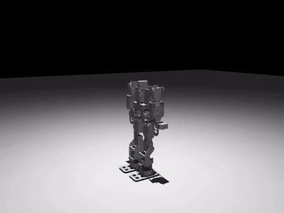
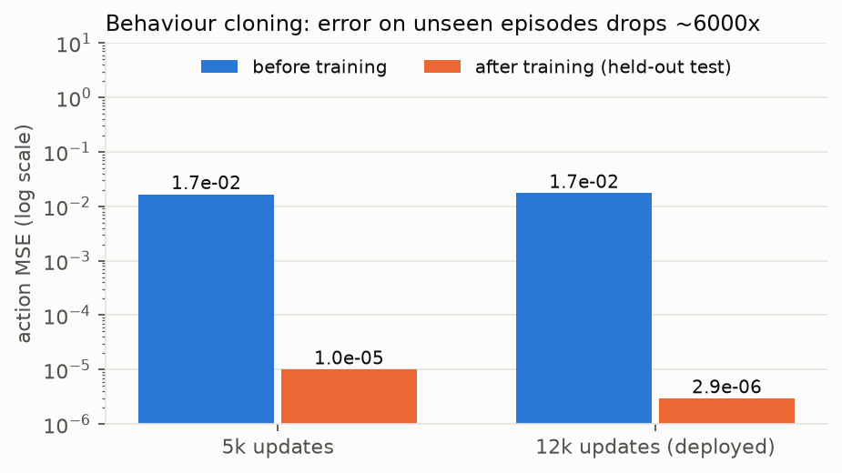
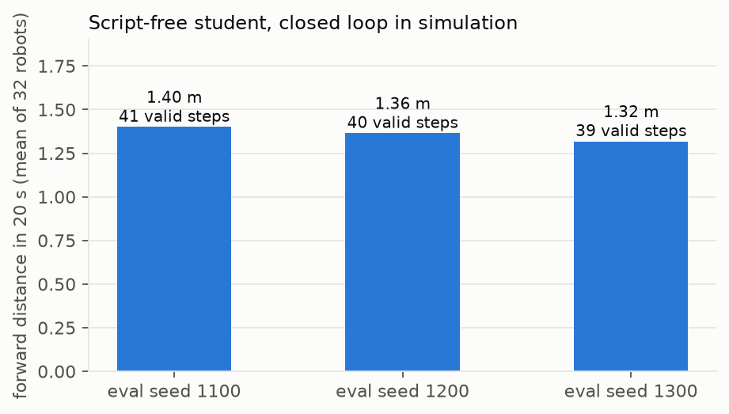
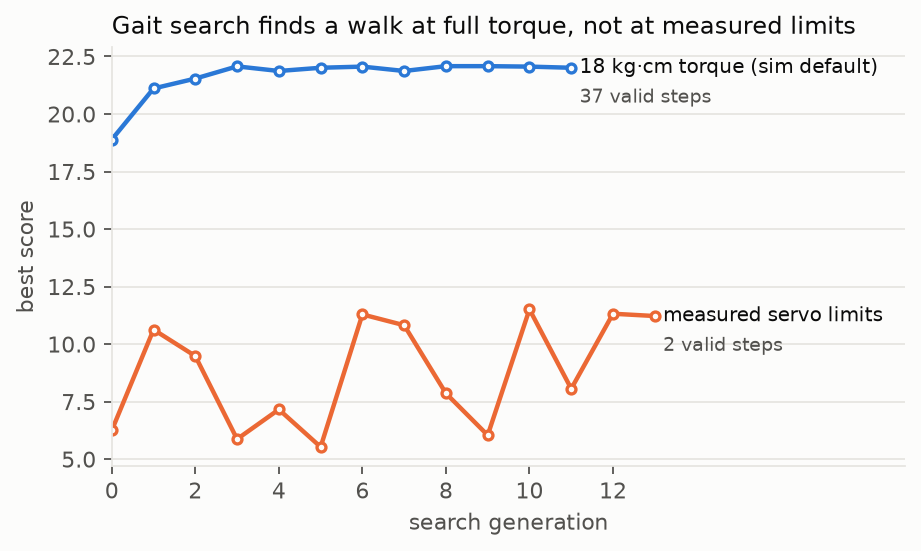
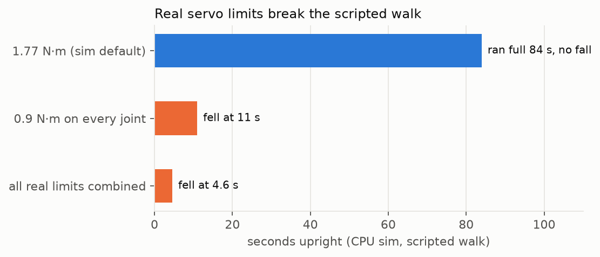
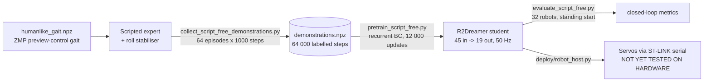

# humanoid-walker: a script-free walking policy for a 19-servo humanoid

A 19-joint servo humanoid (STM32N6 + 2× PCA9685 + MG996R-class servos) is trained to walk in **MuJoCo / MJX-Warp**.
The final policy is a recurrent R2Dreamer (DreamerV3-style) network that reads **45 proprioceptive numbers at 50 Hz** (joint commands + IMU)
and outputs **19 servo targets**. It has no gait table, no phase clock, no stabiliser and no reference trajectory at run time.
It was trained by **behaviour cloning** of a scripted human-like gait (ZMP preview control + roll stabiliser).

<p align="center"></p>
<p align="center"><sub>Trained student, simulation, eval seed 1100: 20 s standing start, 1.2 m forward, 17 + 16 valid steps, no fall.
Full quality: <a href="media/walk_1100.mp4">media/walk_1100.mp4</a> · frames: <a href="media/contact_sheet.png">contact sheet</a></sub></p>

> **Status (14 Oct 2026): simulation only.** Nothing has been run on the physical robot, and the evaluation harness itself reports
> `walking_qualified: false` (completing an evaluation is not proof of walking). The simulator still assumes **1.77 N·m on every joint**, while the
> knees measure about **1.08 N·m**; the scripted walk falls under the measured limits (see [Results](#results)). Read [Limitations](#limitations) before trusting any number here.

## Contents
[Results](#results) · [How it works](#how-it-works) · [Repo layout](#repo-layout) · [Quick start](#quick-start) · [Reproduce the training](#reproduce-the-training) · [Deployment](#deployment) · [Run on the robot](#run-on-the-robot) · [Knowledge graph](#knowledge-graph) · [Limitations](#limitations) · [History](#history)

## Results

| | Result | Source |
|---|---|---|
| Behaviour-cloning error on held-out episodes | 1.7e-2 → **2.9e-6** action MSE (12 000 updates) | [`results/pretraining/bc12k_realistic.json`](results/pretraining/bc12k_realistic.json) |
| Closed loop, standing start, 20 s, 32 robots × 3 seeds | **1.32–1.40 m** forward, 39–41 valid steps, 0 / 0 / 3 % falls | [`results/evals/`](results/evals) |
| Share of simulated robots that walk (history notes) | about 100 / 100 / 97 % for the three seeds | [`docs/PROJECT_HISTORY.md`](docs/PROJECT_HISTORY.md) |
| Same student, single seed-1100 rollout | 1.20 m, 33 valid steps (17 L / 16 R), height 0.296 m at the end | [`results/walk_demo_run.log`](results/walk_demo_run.log) |
| Scripted expert under measured servo limits | falls (4.6 s with every real limit applied) | [`docs/PROJECT_NOTES_12Oct.md`](docs/PROJECT_NOTES_12Oct.md) |

<p align="center">


</p>
<p align="center">


</p>

What the numbers mean, honestly:

* The student imitates the expert well (error is ~6000× lower than at initialisation) and keeps walking in closed loop without any reference. The walk is **slow** (~7 cm/s) and the "valid step" counter uses a strict 15 mm lift detector.
* The expert gait was found by a random search ([`tools/gait_search.py`](tools/gait_search.py)). With 18 kg·cm torque it reaches 37 valid steps. With the **measured** servo limits the best it finds is 2 valid steps ([`results/gait_search/`](results/gait_search)).
* "Realistic" in `student_realistic_12k` means realistic **sensing and latency** (40 ms command delay, ICM-20948-level IMU noise, 6 rad/s slew, masked magnetometer and foot sensors). It does **not** mean realistic torque.

## How it works



* **Simulator:** MuJoCo 3.14 + MJX-Warp on the GPU, 20 ms control step, 10 physics sub-steps per decision. Scene: `r2dreamer/envs/mjx_walking/assets/humanoid_rubber_2mm_servo_v2_kp40.xml`.
* **Policy contract:** [`deploy/DEPLOYMENT_SPEC.md`](deploy/DEPLOYMENT_SPEC.md) (input layout, joint order, frames, latency) and [`deploy/contract_clean12k.json`](deploy/contract_clean12k.json) (exact numbers). The checkpoint refuses to load against a simulator whose contract differs.
* **Why behaviour cloning:** earlier RL runs (up to 14 M steps) never produced a step because the vendor gait cannot step in this simulator; the learner on top of a reference was inconclusive. See [`docs/PROJECT_NOTES_12Oct.md`](docs/PROJECT_NOTES_12Oct.md) and [`r2dreamer/docs/`](r2dreamer/docs).

## Repo layout

```
README.md                  this file            START_HERE.md        the original runbook (same text as r2dreamer/docs/SCRIPT_FREE_TRAINING_20261013_V2.md)
SOURCE_MANIFEST.json       SHA-256 of every source file (checked by the launch scripts)
r2dreamer/                 training + simulation source (R2Dreamer, MJX env, configs, scripts, tests, docs)
  envs/mjx_walking/        environment, rewards, scene builder, robot XML + meshes + gait reference
  configs/                 Hydra configs; walking_mjx_script_free.yaml is the one used for the student
  scripts/                 collect / pretrain / evaluate / pipeline / tests / humanlike_walk.py / scripted_walk.py
  scripts/deploy/          setup_script_free.sh, start_script_free.sh (GPU machine launchers)
deploy/                    robot-side code: robot_host.py (50 Hz runner), serial_servo_link.py, watch_policy.py, Windows setup, test protocol
results/                   every number quoted above, as JSON / logs
figures/  media/           plots (regenerate with scripts/make_figures.py) and the walking videos
tools/                     one-off experiment scripts that produced the results (gait search, eval loop)
checkpoints/               trained weights are NOT in git, see checkpoints/README.md
graphify-out/              knowledge graph of this repo (graph.html, GRAPH_REPORT.md, graph.json)
```

## Quick start

Tested layout: Linux or WSL2 (Ubuntu), Python 3.11. Copy the repo into the Linux filesystem (not `/mnt/c`, which is slow).

**A. Look at results, no GPU, 1 minute**

```bash
# watch media/walk_1100.mp4, or open graphify-out/graph.html in a browser
pip install matplotlib && python scripts/make_figures.py        # regenerates figures/ from results/*.json
python3 r2dreamer/scripts/verify_script_free_bundle.py          # checks all 197 source files against SOURCE_MANIFEST.json
```

**B. Build the environment (GPU machine: NVIDIA driver with CUDA >= 12.8, needs internet, ~10 min)**

```bash
cd r2dreamer
bash scripts/deploy/setup_script_free.sh      # builds .venv from requirements-lock.txt, picks a working renderer, apt-installs tmux/EGL
```

It refuses to run if `.venv` already exists (use a fresh copy). No NVIDIA GPU: the CPU-only tools in step C work, training does not.

**C. Watch a walk**

```bash
cd r2dreamer
# scripted human-like gait (CPU MuJoCo viewer; add MUJOCO_GL=glfw for --video on WSL)
.venv/bin/python scripts/humanlike_walk.py --view
MUJOCO_GL=glfw .venv/bin/python scripts/humanlike_walk.py --video ../out.mp4

# the trained student (GPU; checkpoint from the Release page, see checkpoints/README.md)
.venv/bin/python ../deploy/watch_policy.py --repo . --checkpoint ../checkpoints/student_realistic_12k.pt \
    --seconds 20 --seed 1100 --video ../walk.mp4      # add --view for an interactive MuJoCo window
```

**D. Unit tests (CPU)**

```bash
cd r2dreamer
.venv/bin/python -m unittest discover -s scripts -p 'test_*.py'   # some tests skip without GPU / MJX; not re-run when this README was written
.venv/bin/python scripts/check_goal_corridor_reward.py | tail -1   # 85/85 expected per the 12 Oct notes; not re-run here
```

## Reproduce the training

Needs one NVIDIA GPU (developed on an RTX 5090, 32 GB). Settings below are exactly those recorded in
[`results/demonstrations.manifest.json`](results/demonstrations.manifest.json) and `tools/run9.sh`.

```bash
cd r2dreamer && R=$HOME/run1 && mkdir -p $R
export MUJOCO_GL=$(cat .mujoco_gl) XLA_PYTHON_CLIENT_PREALLOCATE=false JAX_PLATFORMS=cuda

# 0. optional GPU admission check (preflight only, fails fast)
SCRIPT_FREE_PREFLIGHT_ONLY=1 SCRIPT_FREE_RUN_DIR=$R/preflight bash scripts/deploy/start_script_free.sh seed=0

# 1. collect 64 expert episodes x 1000 steps, 8 worlds in parallel (expert settings from the gait search, results/gait_search/search_18kg.json)
.venv/bin/python -u scripts/collect_script_free_demonstrations.py --output $R \
    --episodes 64 --worlds 8 --seconds 20 --seed 100 \
    --time-scale 0.9238 --amplitude 1.0925 --stabilizer 0.4872 0.04568 0.2749

# 2. behaviour cloning, 12 000 updates (split: 48 train / 8 validation / 8 test episodes, by seed group)
STARTUP_FRACTION=0.25 .venv/bin/python -u scripts/pretrain_script_free.py --dataset $R/demonstrations.npz --output $R/bc12k --updates 12000

# 3. closed-loop evaluation, 3 seeds, 32 robots each
for S in 1100 1200 1300; do
  .venv/bin/python -u scripts/evaluate_script_free.py --checkpoint $R/bc12k/latest.pt --output $R/eval_$S --seed $S --seconds 20 --worlds 32
done
```

Expected: `final_validation_bc` ≈ 2e-6 in `$R/bc12k/pretraining_report.json` and forward distance ≈ 1.3–1.4 m per eval. Exact numbers will differ a little (GPU non-determinism); the reference run is in `results/`.
If you edit anything under `r2dreamer/`, run `python3 scripts/make_source_manifest.py` first, otherwise the verifier in the launch scripts stops you.
The one-shot version (`SCRIPT_FREE_PREFLIGHT_ONLY=0 ... start_script_free.sh`) runs a bounded pilot that also continues with online RL; read [`START_HERE.md`](START_HERE.md) before using it.

## Deployment

Two targets, with different requirements:

| Target | Purpose | Needs | Entry point |
|---|---|---|---|
| GPU machine (Linux/WSL2, NVIDIA, CUDA >= 12.8) | train, evaluate, render | internet for `uv`/pip, ~10 min setup | `r2dreamer/scripts/deploy/setup_script_free.sh`, then [Reproduce the training](#reproduce-the-training) |
| Robot laptop (Windows, CPU is enough) | run the trained policy at 50 Hz | Python 3.11, ST-LINK USB, the checkpoint | `deploy/setup_windows.bat`, then [Run on the robot](#run-on-the-robot) |

Ship to the robot laptop: `deploy/` + `r2dreamer/` (as `source_v6`) + `student_realistic_12k.pt`. Check the checkpoint hash first (`checkpoints/README.md`). The host refuses to load a checkpoint whose contract differs from the source tree. Nothing in this repo has been run on the physical robot, so treat deployment as bring-up, not production.

## Run on the robot

**Not validated on hardware.** Follow [`deploy/ROBOT_TEST_PROTOCOL.md`](deploy/ROBOT_TEST_PROTOCOL.md) in order (Gate 0 bench → Gate 4 free walk; a person at the power switch for every gate).
The host runs on a laptop (CPU is enough: ~7–8 ms per step with 4–8 threads) and talks to the board over one ST-LINK virtual COM port.

```bat
:: Windows: from deploy\ (copy checkpoint and a source_v6 tree next to it first)
setup_windows.bat
robot_env\Scripts\python robot_host.py --repo <path-to>\r2dreamer --checkpoint student_realistic_12k.pt --selftest   :: no robot, 30 s
robot_env\Scripts\python robot_host.py ... --port COM5 --dry-run        :: real IMU, servos off (Gate 1)
```

Before any powered run you must supply, per joint, the servo neutral (µs), sign, µs/rad and hard limits, and verify the IMU axes with a lean test. These are unknown in this repo ([`deploy/DEPLOYMENT_SPEC.md`](deploy/DEPLOYMENT_SPEC.md) §2, §5, §8).

## Knowledge graph

[`graphify-out/`](graphify-out) holds a graph of the whole repo built with [graphify](https://graphify.com) (code by AST, the 16 Markdown docs and the contact sheet by LLM extraction; the earlier chats are included only as the distilled `docs/PROJECT_HISTORY.md`, never as raw transcripts):
**1831 nodes, 4117 edges, 115 communities**, 95 % of edges extracted directly from source (5 % inferred, avg confidence 0.85).

* Open `graphify-out/graph.html` in a browser to explore; `graphify-out/GRAPH_REPORT.md` has god nodes, communities and suggested questions.
* Core abstractions by connectivity: `MJXTeacherEnv` (simulator bridge), `Dreamer`, `OnlineTrainer`, the training-contract builder/checker (`build_training_contract`, `check_checkpoint_contract`), `ImitationDataset`.
* The graph links the hardware findings in the docs (e.g. "sim torque 1.77 N·m vs real knee 1.08 N·m") to the code that depends on them (`robot_host.py` → `ScriptFreePolicy`).
* Caveats: the labels for the largest clusters were written by hand, about half of the rest are `Community N`. The health check flagged 839 edges whose endpoint is not a node (mostly imports of third-party modules); YAML configs, XML scenes and STL meshes are not in the graph; code nodes created from the docs carry the wrong `source_file` in some cases.
* Query it: `graphify query "how does the checkpoint contract get enforced?"` (run in the repo root).

## Limitations

1. **Torque:** simulator = 1.77 N·m on all joints; measured knees ≈ 1.08 N·m. Gait search and scripted walk fail under measured limits. The student was trained on the optimistic torque.
2. **No hardware test.** Servo calibration, joint sign conventions and IMU axes (a 14–16° resting tilt was seen in the first real capture) are unverified; the host applies a start-up gravity calibration that is only valid if the robot is upright.
3. **Student ≈ expert.** It is a behaviour-cloned copy of a scripted gait, not an independent learner; no DAgger. Online RL was tried and **breaks** the cloned gait (see [`docs/PROJECT_HISTORY.md`](docs/PROJECT_HISTORY.md)), so it is not used.
4. **Slow walk** (~7 cm/s) and a strict step detector; evaluation horizon is 20 s, not 100 m.
5. Mass in simulation is 3.0 kg vs ≈ 2.66 kg real; supply sag, backlash and foot friction are not modelled.
6. Several scripts and docs in `r2dreamer/` are from earlier experiments (teacher curricula, interactive pose editor); they are kept because the source manifest and tests reference them.

## History

| Date (2026) | What happened |
|---|---|
| 4–7 Oct | R2Dreamer + MJX teacher environment, standing curricula, interactive pose-injection tool |
| 8–9 Oct | Servo scene fixes (limp servo root cause), goal-corridor reward v3; 14 M-step runs never step |
| 10–12 Oct | Found the vendor gait cannot step in sim; wrote scripted IK walk, then the human-like ZMP walk (6.2 cm/s); real IMU/servo measurements arrive |
| 13 Oct | Script-free student: demonstrations + behaviour cloning (5k then 12k updates), closed-loop evals, deployment spec and robot host |
| 14 Oct | Stand-still IMU calibration added; walking video recorded; this repository assembled |

Full history, dead ends and open hardware items: [`docs/PROJECT_HISTORY.md`](docs/PROJECT_HISTORY.md). Details: [`docs/PROJECT_NOTES_12Oct.md`](docs/PROJECT_NOTES_12Oct.md), [`r2dreamer/docs/`](r2dreamer/docs), [`deploy/DEPLOYMENT_SPEC.md`](deploy/DEPLOYMENT_SPEC.md).

## Publishing (maintainer)

`bash scripts/publish.sh private` (or `public`, which requires a `LICENSE` file) creates the GitHub repo with `gh` and pushes `main`; add `--with-checkpoint /path/to/student_realistic_12k.pt` to also upload the weights as a Release asset after a hash check.

## License

No license has been chosen yet; add one before making the repository public. The robot meshes come from the robot vendor and may carry their own terms.
