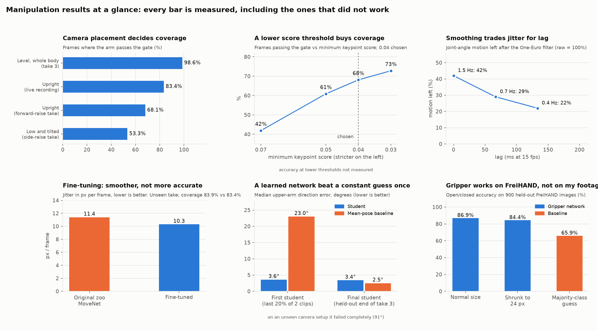

# Manipulation: a humanoid arm that copies you from a camera

The robot's right arm (shoulder, arm, elbow, gripper) copies a person's right arm, seen by the STM32N6570-DK's own board camera. It runs in a **MuJoCo simulation** today;
the same code path drives the **real servos** over a serial link (built and bench-tested in dry mode, not yet run on the arm).

<p align="center"></p>
<p align="center"><sub>Left: the board camera, head pixelated, detected arm drawn on it. Right: the simulated humanoid. 40 s, arm found in 92 % of frames.
<a href="media/arm_copies_you.mp4">Full video</a>. <b>Simulation only</b>; only the person's right arm (image left) is copied.</sub></p>

## The idea in 30 seconds

* **What:** no motion capture, no gloves. One camera and a pre-trained pose model (MoveNet, int8, small enough for the N6's NPU) find shoulder, elbow and wrist.
* **How:** a plausibility gate throws out junk detections, **inverse kinematics** fits the robot's joints to the person's arm direction *within the robot's reachable range*, and a One-Euro filter smooths the result.
* **Why this and not RL or a big model:** the task is *pose copying* for a 3-joint arm with no objects, so there is no reward to learn from and nothing for a large policy to add. I tried a learned version anyway; it did not beat plain IK
  ([design choices](#design-choices), [what broke](#what-broke-and-what-i-would-do-next)).

## Try it in 5 minutes

```bash
pip install -r requirements.txt                    # numpy, opencv, mujoco, onnxruntime, ai-edge-litert, pyserial
python replay.py                                   # NO camera, NO downloads: bundled keypoints -> simulated humanoid -> replay_out.mp4 (~70 s on a laptop CPU)
python -m unittest discover -s tests               # 13 tests: gate, depth cue, filter, IK, robot driver, the sample
python models/fetch_zoo_models.py                  # only for the live demo: ST's MoveNet (13 MB; ST licence, so not committed)
python demo.py                                     # live camera -> simulated humanoid  (q quits; --url http://IP:8080/video for a phone camera)
```

The humanoid model uses the meshes already in this repo (`../r2dreamer/...`). `replay.py` reads [`data/sample/live_keypoints.json`](data/sample): skeleton keypoints of one real 53 s recording, no pixels (the raw video shows a person and stays private).

## Results

<p align="center"></p>

| What | Measured | Where |
|---|---|---|
| Arm found, camera level and whole body in view / upright / low and tilted | **98.6 % / 83.4 % / 53.3 %** of frames | [`results/measurements.json`](results/measurements.json) |
| IK: robot arm direction vs the person's, frames where the arm is found | median **0.2 to 1.2 degrees** on most takes (worst: 3.4 forearm) | `eval/pose_offline.py` |
| One-Euro filter at 0.7 Hz | **29 %** of the raw joint jitter left, 1 frame (67 ms) of lag | `tests/`, measurements |
| Fine-tuned vs original MoveNet, unseen take | **9 % less jitter**, same coverage; *not shown to be more accurate* | measurements |
| Gripper network on held-out FreiHAND | **86.9 %** open/closed (84.4 % at 24 px) vs 65.9 % for the majority class | measurements |
| Gripper on my own footage | **not reliable** | [below](#what-broke-and-what-i-would-do-next) |
| Laptop to STM32 link, dry mode | 5 of 5 checks pass, 100 frames, 0 bad CRC | [firmware README](firmware/camera_walker/README_CAMERA_WALKER.md) |

## Design choices

| Option | Verdict | Why |
|---|---|---|
| **Kinematic retargeting + IK** (chosen) | used | 3 joints, a clear geometric target, runs in real time, explainable failures. Matching segment *directions* (not an end-effector point) suits a short arm whose reach differs from a person's. |
| Learned image-to-joints network (distil MoveNet + IK) | tried, not used | Beat a constant guess on one split, not on the next, and collapsed on a camera it had not seen ([dashboard](#results)). Needs far more data than I could record. |
| RL / world model | not used | No objects, no task reward, no contact: the signal is the human pose itself. (The locomotion project uses a world-model policy because walking *is* a control problem.) |
| VLA / large pre-trained policy | not used | A language-conditioned policy adds nothing to copying three joint angles, and cannot run on the N6. |
| Custom keypoint model | not used | A pre-trained pose model already generalises to people and rooms it never saw; fine-tuning bought smoothness only. |

## Data: how I got it, how I cleaned it

**Capture.** About 12 minutes of video across 10 recordings (kept private): the STM32N6570-DK's **own UVC camera** at 640x480, with a phone over USB tethering as a fallback ([`data_collection/record_frames.py`](data_collection/record_frames.py)).
Why: it costs nothing extra, it is the deployment sensor (no camera gap), and a pose model labels the frames, so there is no hand annotation. FreiHAND (hands) is used only for the gripper.

| Problem in consumer-camera data | What the pipeline does | Where |
|---|---|---|
| Junk keypoints when the body is cut off or too close | gate: confident keypoints, level shoulders, sensible segment lengths, nothing on the image border, not a close-up | `armcopy/pose.py` `arm_vectors` |
| Jitter | label smoothing over +-2 frames (training); One-Euro filter (run time) | `preprocessing/label_arm.py`, `armcopy/filters.py` |
| Missing frames / occlusion | hold the last pose ~1 s, then ease to rest instead of freezing or flailing | `demo.py`, `replay.py` |
| Image coordinates vs the robot | image plane to a front view (outward, up); forward reach from foreshortening of the arm, normalised by shoulder width | `armcopy/pose.py`, `armcopy/sim.py` |
| Camera calibration | **none**: the intrinsics are unknown, so geometry uses image-plane directions only; lens distortion and perspective from a low camera are ignored (and show up as the 53 % coverage) | none |
| Sharing data that shows a person | `preprocessing/extract_keypoints.py` keeps keypoints only | `data/sample/` |

## Bridging the embodiment gap

A person's arm reaches overhead; the robot's shoulder reaches about 108 degrees from straight down and its elbow plus or minus 86. So the IK target is **compressed into the reachable range first**, then fitted
by damped Gauss-Newton on the robot's own kinematics (`armcopy/sim.py`). A single front camera cannot see depth, so an arm pointing at the camera is detected by how *short* it looks and assumed to reach toward the camera.
Joint directions and signs for the real servos are not guessed: `robot/arm_jog.py` measures them on the robot.

## Simulation and what is not physical

MuJoCo 3.16, the same humanoid model as the locomotion project (`assets/humanoid`). **In this project the arm is driven kinematically**: joint angles are set and the scene is re-posed; there are no dynamics, no actuator
lag, **no objects, no contact and no grasping**. The locomotion project does simulate friction and contact; this one does not. The gripper is a joint angle, not a grasp.

## What broke, and what I would do next

| What broke | Evidence | What I tried / learned |
|---|---|---|
| **Hand-only student** (first attempt) | 5.97 cm fingertip error vs 13.64 cm on an unseen close-up clip; fails from 2 m | the hand is too small at distance, so I switched to whole-arm pose (`experiments/hand_student/`) |
| **Learned image-to-joints network** | 3.6 vs 23.0 degrees once, 3.4 vs 2.5 on the next split, 91 degrees on a new camera | it memorises one view; not better than MoveNet + IK |
| **Fine-tuning MoveNet** | 9 % less jitter, equal coverage, wrists differ by a median 19 px with no ground truth | the honest claim is *smoother*, not *more accurate* |
| **Gripper on my footage** | reads open for almost everything; the crop often misses the hand | crop placed from the wrist and forearm direction; a skin-colour search over three candidates helped a little; a hand detector or labelled crops would fix it |
| **Camera placement** | 98.6 % vs 53.3 % coverage | mount level at chest height, ~2 m; a low tilted camera costs more than any model change |
| **Real arm** | not driven yet | firmware limits for the arm are tiny (walking limits), servo directions unmeasured, left shoulder servo suspected faulty |
| **Overhead arms** | 15 to 30 % of frames are beyond the robot's range | compressed, not matched |

**With two more weeks:** (1) drive the real arm with measured limits and film it next to the simulation; (2) hand-label ~300 wrist positions to measure accuracy instead of agreement; (3) a physical sim: PD actuators with the real servo lag
plus a cube, to test contact and grasping; (4) a small hand-keypoint model for the gripper trained on my own crops; (5) calibrate the camera and move from image-plane to metric geometry.

## Layout

```
manipulation/
  armcopy/            core library: pose + gate, sim + IK, filters, grip crop, robot driver, nets
  data_collection/    record_frames.py, download_freihand.py
  preprocessing/      label_arm.py (frames -> robot joint angles), extract_keypoints.py (frames -> shareable keypoints)
  models/             train_arm_student, finetune_movenet, train_grip, export_*, fetch_zoo_models
  sim/                make_demo_video.py (the clip above), student_sim_video.py
  eval/               pose_offline.py, arm_eval.py, check_faces.py, make_figures.py, make_dashboard.py
  robot/              arm_jog.py (measure the real arm's range and directions)
  experiments/        the first, hand-only attempt (kept, separate)
  firmware/           camera + servo firmware for the N6 (my files and patches only)
  tests/  data/sample/  weights/  figures/  results/  media/  assets/
  demo.py  replay.py  requirements.txt
```

Everything is plain Python scripts with docstrings that show their usage, and no hard-coded paths. No Dockerfile: the live demo needs a USB camera and the replay needs only three pip packages. Weights: [`weights/grip_v2.onnx`](weights) (research use, FreiHAND-trained).
The fine-tuned MoveNet is a derivative of ST's model and is not redistributed; `models/finetune_movenet.py` + `models/export_movenet_int8.py` rebuild it from your own recordings.

## The real arm and the firmware

```bash
python robot/arm_jog.py --port COM3                  # slow manual jog: safe range and direction of each joint
python demo.py --robot-port COM3                     # dry run: shows the pulses it would send
python demo.py --robot-port COM3 --live              # moves the right arm: slew-limited, clamped; e = home, k = relax
```

`armcopy/robot.py` clamps every pulse, limits slew (200 us/s), keeps the STM32's 100 ms watchdog fed at 50 Hz and holds every other joint at neutral. The firmware clamps again to its own limits.
[`firmware/camera_walker`](firmware/camera_walker) merges the servo link into ST's camera app, so one N6 image streams video *and* takes servo frames (builds, signs, flashes; link test passes; no IMU in that build).
Robot hanging, hand on the power switch.

## Third-party material

| Item | Use | Licence / note |
|---|---|---|
| MoveNet (Google) via the ST model zoo | pose model | ST model zoo, SLA0044; not committed, `models/fetch_zoo_models.py` downloads it |
| ST `x-cube-n6-camera-capture`, STM32 HAL, ST Edge AI | firmware base, NPU compiler | BSD-3 / Apache-2.0 / ST licence; only patches and my files are committed |
| FreiHAND (Freiburg) | gripper training | research use; no images committed, `data_collection/download_freihand.py` fetches a subset |
| MediaPipe Hands 0.10.21 | labels for the first experiment only | Apache-2.0 |

Built on a laptop (Intel Core i5-13500H, 16 GB RAM, NVIDIA GeForce RTX 4060 Laptop GPU 8 GB, Windows + WSL2): PyTorch 2.8 (CUDA 12.8) for the small networks, TensorFlow 2.18 on CPU for the MoveNet fine-tune.
My own recordings are not published; only derived numbers, plots, the keypoint sample and the pixelated demo clip.
