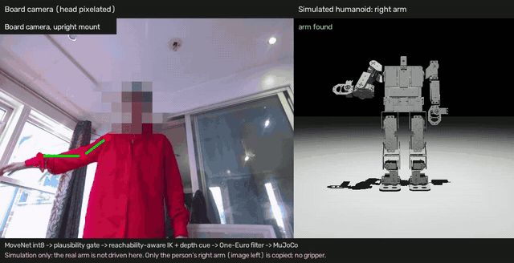
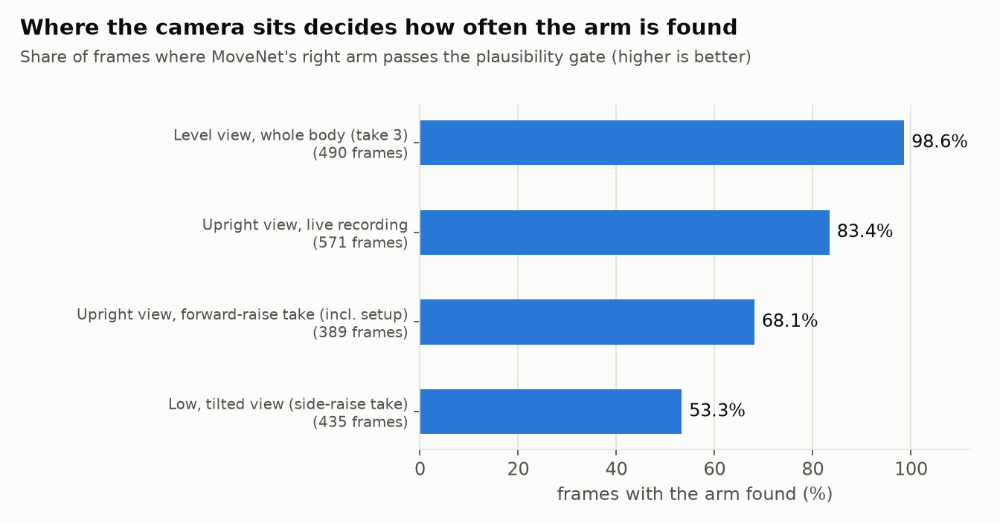
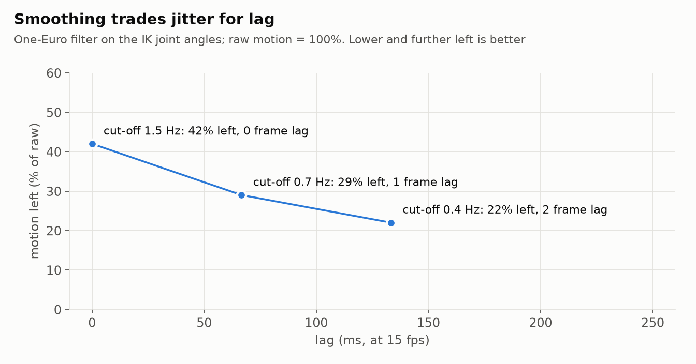
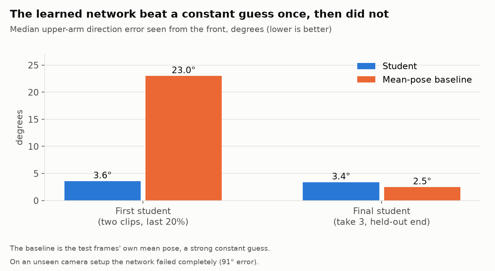
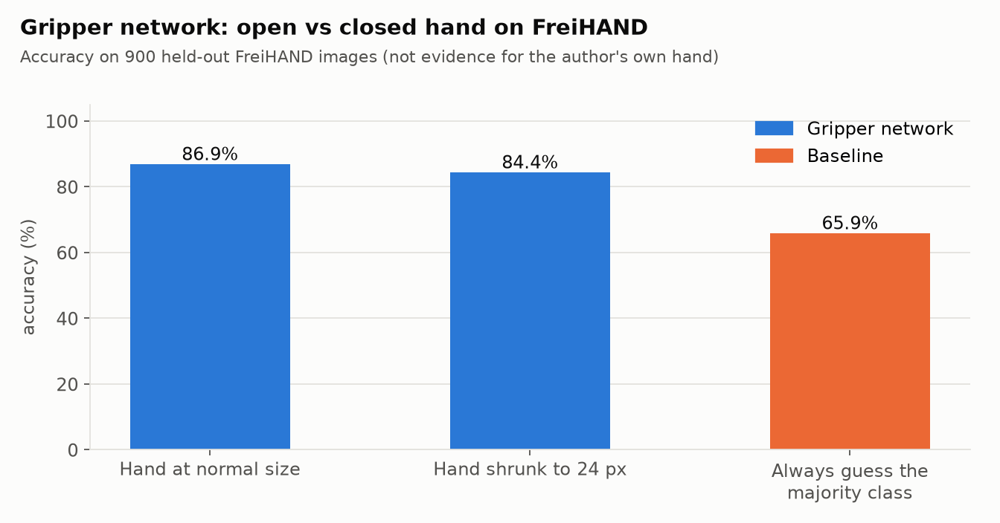
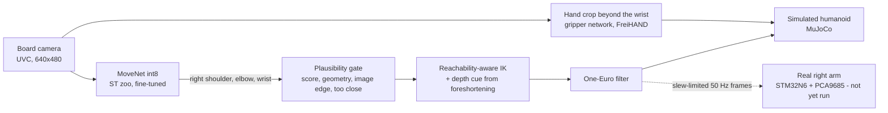

# Manipulation: a humanoid right arm that copies you from a camera

A camera watches a person. The robot's right arm (4 servos: shoulder, arm, elbow, gripper) is moved to copy the person's right arm, first in a **MuJoCo simulation**,
then, through the same code path, on the **real robot** over a serial link. The camera is the STM32N6570-DK's own board camera.

**Nothing here uses a pre-recorded robot motion.** A pre-trained pose model finds your shoulder, elbow and wrist; geometry turns that into robot joint angles that the
real servos can actually reach; and every number that "looks good" in this README has a measured number next to it, including the ones that did not work.

> **Status (15 Oct 2026): simulation + live camera.** The real arm has **not** yet been driven by this pipeline. The hardware path is built and bench-tested in
> dry mode only (laptop to STM32 link test: 5 of 5 pass, 100 frames, 0 bad CRC; no servo output). The demo clip is below (simulation only).
> Read [What did not work](#what-did-not-work) before trusting any figure.

## Demo

<p align="center"></p>
<p align="center"><sub>Left: the board camera (head pixelated), with the detected right arm drawn on it. Right: the simulated humanoid copying that arm. 40 s, the arm is found in 92 % of frames.
Full video: <a href="media/arm_copies_you.mp4">media/arm_copies_you.mp4</a>. <b>Simulation only</b>: the real arm is not driven in this clip, and only the person's right arm (image left) is copied.</sub></p>

The clip comes from one live recording with the camera upright (two stretches, 40 s). In my other recording I mostly moved the *other* arm, which the robot does not copy, so it makes a poor demo.
Build it yourself from saved frames: `python tools/make_demo_video.py --out raw.mp4 --segment "FRAMES_DIR|FIRST|LAST|SRC_FPS|LABEL"` (then re-encode with `ffmpeg -c:v libx264 -pix_fmt yuv420p`).
The head is pixelated from two independent estimates, and `python tools/check_faces.py media/arm_copies_you.mp4` runs a face detector over every frame as a check: 6 hits in 600 frames, all on the outstretched hand against a bright window and none on the head (checked by eye). A detector can miss faces, so look at the video too.

## Results

| What | Result | Source |
|---|---|---|
| Arm found (passes the plausibility gate) with the camera level and the whole body in view | **98.6 %** of frames | [`results/measurements.json`](results/measurements.json) |
| Same, camera upright, live recording | **83.4 %** (571 frames) | same |
| Same, camera low and tilted up | **53.3 %**: where the camera sits matters more than any model | same |
| IK: how closely the robot's arm direction matches the person's, on frames where the arm is found | median **0.2 to 1.2 degrees** on most takes (worst take: 3.4 on the forearm) | `tools/pose_offline.py` |
| Smoothing (One-Euro filter) | **29 %** of the raw joint jitter left, **1 frame** of lag (15 fps) | [`results/measurements.json`](results/measurements.json) |
| Fine-tuning the zoo MoveNet on my own footage | **9 % less jitter**, same coverage (83.4 vs 83.9 %); not shown to be more accurate | same |
| Gripper network on held-out FreiHAND images | **86.9 %** open/closed (84.4 % with the hand shrunk to 24 px) vs 65.9 % for always guessing the majority | same |
| Gripper on my own camera footage | **not reliable**: the crop often misses the hand | [What did not work](#what-did-not-work) |

<p align="center">


</p>
<p align="center">


</p>

## How it works



* **Pose:** ST's model-zoo MoveNet (192 px, int8). Fine-tuned on my own board-camera takes (self-training on its own cleaned-up keypoints, other keypoints kept by distillation),
  exported to int8, and compiled for the STM32N6 NPU with ST Edge AI (2.6 MB of weights). See [`tools/finetune_movenet.py`](tools/finetune_movenet.py).
* **Gate:** a detection is used only if all keypoints are confident, both shoulders are level, the arm segments have sensible lengths, nothing sits on the image border
  (a cut-off body gives junk), and the person is not too close to the lens. Frames that fail make the robot ease back to rest instead of freezing or flailing.
* **IK:** fits the robot's shoulder, arm and elbow so its arm points the same way as yours *as seen from the front*. The robot cannot reach everything a person can
  (its shoulder reaches about 108 degrees from straight down, the elbow plus or minus 86), so targets are compressed into the reachable range first. A single front camera cannot see depth,
  so forward reach comes from **foreshortening** (an arm pointing at the camera looks short) and assumes you reach *toward* the camera.
* **Robot output:** [`tools/robot_arm.py`](tools/robot_arm.py) clamps every pulse to the measured limits, limits slew rate (default 200 microseconds per second), keeps the STM32's
  100 ms watchdog fed from a 50 Hz thread, and holds every other joint at neutral. Dry-run by default.

## Quick start (simulation, live camera)

Python 3.11, Windows (the board camera is a USB UVC device; WSL cannot see it).

```bash
python -m venv .venv && .venv\Scripts\pip install -r requirements.txt
python tools/fetch_zoo_models.py                  # ST zoo MoveNet (not redistributed: SLA0044); 13 MB
python tools/demo_live.py --rotate 0              # camera | simulated humanoid; q quits
```

The humanoid model reuses the meshes already in this repo
(`../r2dreamer/envs/mjx_walking/assets/meshes`); nothing is duplicated.
Keys in the window: `g` gripper on/off, `u` / `f` calibrate the gripper with your hand open / as a fist, `c` save raw frames (private), `r` record the robot panes only, `q` quit.
Useful options: `--smooth 0.4` (smoother, laggier) to `1.5` (livelier), `--url http://IP:8080/video` for a phone camera, `--index N` for another camera.
Gripper (optional): `python tools/download_freihand.py data/freihand 6000`, then, with PyTorch + CUDA installed, `python tools/train_grip.py data/freihand export --tag grip_v2 --epochs 40` creates `export/grip_v2.onnx`; without it the demo runs with the gripper disabled.

No camera? Run the pose pipeline on saved frames: `python tools/pose_offline.py FRAMES_DIR out.mp4 --no-video` prints the arm-found rate and the IK match error.

## Moving the real arm (read first)

```bash
python tools/arm_jog.py --port COM3               # slow manual jog: measure each joint's safe range and direction
python tools/demo_live.py --robot-port COM3       # dry run: shows the pulses it WOULD send
python tools/demo_live.py --robot-port COM3 --live   # really moves the right arm (slow, clamped); e = home, k = relax
```

Robot hanging or supported, a hand on the power switch. The firmware **also** clamps to its own compiled limits (the walking limits are tiny for the arm), so widen them first
with the firmware console (`limits`, `neutral`, `export csv`). The step-by-step is in [`firmware/camera_walker/README_CAMERA_WALKER.md`](firmware/camera_walker/README_CAMERA_WALKER.md).

## One firmware for camera and servos

The N6 board cannot normally stream UVC video and take servo commands at the same time, because they are two different programs. [`firmware/camera_walker`](firmware/camera_walker)
adds the walker servo link (from the locomotion project) as a FreeRTOS task inside ST's `x-cube-n6-camera-capture` app: one image, camera on the user USB port, servo console and
frames on the ST-LINK serial port. Only **my** files and small patches are committed (ST's code is not redistributed); the README there says how to apply them.
It builds with CubeIDE's toolchain, signs, and flashes with STM32CubeProgrammer; the dry-mode link test passes against it. **No IMU stream in this build.**

## What did not work

* **Hand-only student (the first attempt).** A MobileNetV2 trained on close-up hand footage drove a simulated arm well on an unseen clip (5.97 cm mean fingertip error vs 13.64 cm for a constant guess, 79 % gripper accuracy)
  but only when the hand fills the picture. From 2 m the hand is tiny and it fails. This is why the pipeline moved to whole-arm pose. Code kept in `tools/build_dataset.py`, `train_student.py`, `sim_arm_eval.py`.
* **A learned image-to-joints network** (distilling MoveNet + IK into one network that could run on the chip). On a held-out stretch it beat a constant guess once (3.6 vs 23.0 degrees) and then did not (3.4 vs 2.5 on the end of take 3).
  Moved to a camera setup it had not seen it failed completely (91 degrees of error). Camera position has to match training; with the data I had it is not better than MoveNet + IK.
* **Fine-tuning MoveNet** gives smoother keypoints (about 9 % less jitter on an unseen take) but the same coverage, and the two models' wrists differ by a median 19 px with no ground truth to say which is right.
  The honest claim is *smoother*, not *more accurate*.
* **Gripper from my own footage.** The FreiHAND-trained network separates open and closed hands in its own test set, but on my camera the hand crop (placed from the wrist and forearm direction) often lands on a sleeve or blur,
  and an open palm reads low while a fist is read as closed only sometimes. Treat the gripper as an experiment; `u`/`f` calibration helps but does not fix the crop.
* **The real arm.** Not driven yet. The firmware's compiled limits for the arm are too small to follow a person, the servo directions are still to be measured on the robot, and the left shoulder servo is suspected to be faulty.
* **Overhead arms.** In the later takes 15 to 30 % of frames go beyond what the robot's shoulder can do (up to 71 % in an early take with the arm often overhead); they are compressed, not matched.

## Built on

| | |
|---|---|
| Computer | Laptop: Intel Core i5-13500H, 16 GB RAM, **NVIDIA GeForce RTX 4060 Laptop GPU (8 GB)**, Windows + WSL2 (Ubuntu 22.04) |
| Training | PyTorch 2.8.0 (CUDA 12.8) for the gripper and the joint-space network (seconds to minutes); TensorFlow 2.18 on CPU for the MoveNet fine-tune (about 3 minutes per epoch) |
| Robot | STM32N6570-DK, 2x PCA9685, MG996R-class servos, the board camera over USB (UVC) |
| Simulation | MuJoCo 3.16, the same humanoid model as the locomotion project |

## Third-party material

| Item | Use | Licence / note |
|---|---|---|
| MoveNet (Google) via the ST model zoo | pose model, fine-tuned here | ST model zoo, SLA0044. Weights are **not** committed; `tools/fetch_zoo_models.py` downloads them |
| ST `x-cube-n6-camera-capture`, STM32 HAL | camera firmware base | BSD-3-Clause / Apache-2.0 per ST's package; only patches and my files are committed |
| ST Edge AI 4.1 | compiles the int8 model for the N6 NPU | ST licence; generated code and blobs not committed |
| FreiHAND (Freiburg) | gripper training data | research / non-commercial use; **no images are committed**, `tools/download_freihand.py` fetches a subset |
| MediaPipe Hands 0.10.21 | labels for the early hand experiment only | Apache-2.0 |

My own recordings (which show a person) are **not** published: only derived numbers, plots and, later, robot-only video.

## Layout

```
manipulation/
  tools/       pose, IK, simulator view, live demo, real-arm driver, training/export scripts, make_figures.py
  assets/      humanoid.xml + standing pose (meshes come from ../r2dreamer)
  firmware/    camera_walker: servo task + patches for ST's camera app, flash scripts, calibration table
  media/       demo clip (mp4 + gif), robot-only extras can be added here
  figures/     the four charts above (made by tools/make_figures.py from results/measurements.json)
  results/     measurements.json
```
